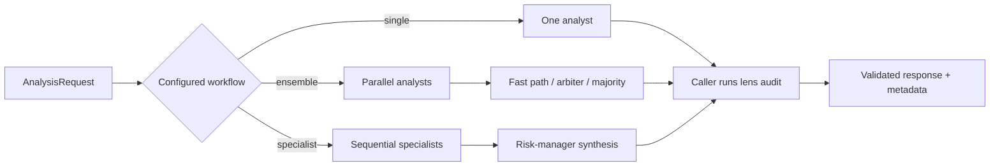

# internal/analysis — LLM Analysis Engine

Builds prompt-safe market context, dispatches configured model providers, and
returns an auditable provider or aggregate decision. The package supports
single analysts, adaptive-depth ensembles, arbitration, and sequential
specialists; the caller owns final lens validation.

## Components

| Area | Purpose |
|---|---|
| `models.go` | Provider interface plus request, response, and call-metadata contracts |
| `analyzer.go`, `ensemble.go` | Single/ensemble routing, fast path, majority fallback, and arbitration |
| `specialist.go`, `prompts/roles.go` | Sequential specialist and risk-manager workflow |
| `lens_audit.go` | Validates selected/rejected lenses against an execution profile |
| `prompts/stock.go` | Generalist stock prompt and strategy guidance |
| `prompts/timeframe_context.go` | Primary-thesis context for entry-confirmation passes |
| `anthropic.go`, `openai.go`, `gemini.go`, `deepseek.go`, `ollama.go` | Model-provider adapters |
| `cache/`, `classifier/`, `depth/` | Prompt caching, impact classification, and adaptive analyst depth |

## Request Context

`AnalysisRequest` can carry:

- recent candles, computed indicators, news, and portfolio state;
- knowledge-graph, similar-analysis, and performance context;
- scanner discovery provenance and a validated execution profile;
- deterministic pullback facts when `pullback_strength` is admissible; and
- a timeframe role plus the completed primary thesis for entry confirmation.

A valid execution profile owns the ordered analyst menu. Discovery-source
labels explain why the candidate was found and are never offered as strategies.
Legacy callers can still supply `Strategy`/`Strategies` without a profile.

## Decision Contract

The stock response contains:

- `action`: `BUY`, `SELL`, `HOLD`, or `WAIT`;
- confidence, sizing, stop, target, and reasoning;
- the observed regime;
- one selected admissible lens, or `none`; and
- a reason for rejecting every other admissible lens on actionable BUYs.

`Analyzer.Analyze` and `Analyzer.AnalyzeFull` do not perform the final lens
audit. Callers must pass their result to `ValidateFinalLensSelection` before
trusting a profile-bound BUY. The engine does this before persistence and
execution: invalid lens selection or incomplete rejection coverage becomes a
non-directional HOLD. SELL decisions are exits and are not suppressed by
ordinary entry-lens validation.

## Analysis Workflows

For scanner profiles with an entry-timing timeframe, the engine can issue a
second request with role `entry_confirmation`. That request evaluates timing
for the already-selected thesis; it cannot substitute a new lens or create an
independent exit. The engine owns the fail-closed merge policy.

## Audit Metadata

`ModelCallMeta` captures provider/model identity, prompt hash, raw prompt and
response, token counts, latency, and the indicator snapshot. The store retains
that raw metadata for the primary analysis plus selected/rejected lenses,
regime, scanner lineage, and the compact timeframe-workflow audit. Entry
confirmation records cost and compact status/action/lens/reason fields in that
workflow audit; its raw prompt and provider response are not persisted.
