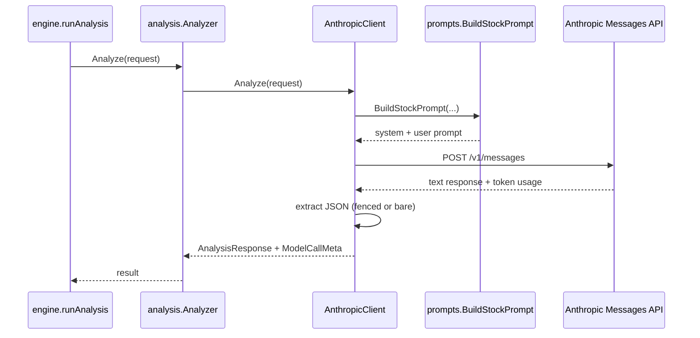

# internal/analysis — LLM Analysis Engine

Implements Phase 3 analysis flow: prompt construction → model call → structured JSON parsing → metadata capture for storage.

## Components

| File | Purpose |
|---|---|
| `models.go` | `ModelProvider` interface, `AnalysisRequest`, `AnalysisResponse`, metadata types |
| `anthropic.go` | Claude adapter via Anthropic Messages API (`net/http`) |
| `analyzer.go` | Provider registry/factory + primary dispatch |
| `openai.go` | Stub provider (`not implemented`) |
| `ollama.go` | Stub provider (`not implemented`) |
| `prompts/stock.go` | PRD §8.1 stock prompt template builder |

## Data Flow

## Prompt Contract (PRD §8)

Prompt sections are always emitted in this order:
1. system rules (strict JSON output)
2. market data (recent OHLCV)
3. indicators
4. portfolio context (placeholder in Phase 3)
5. recent news (last 48h)
6. knowledge graph context (placeholder)
7. similar past analyses (placeholder)

## Output Contract

`AnalysisResponse` fields:
- `action`: `BUY | SELL | HOLD`
- `confidence`: `0.0..1.0`
- `size_pct`
- `stop_loss`
- `take_profit`
- `reasoning`

Adapter validation rejects invalid action/confidence ranges.

## Metadata Captured

`ModelCallMeta` includes:
- prompt hash (SHA-256)
- raw prompt + raw model response
- token usage (input/output)
- latency (ms)
- indicator snapshot JSON

This metadata is persisted to `analyses` for auditability and later backtesting.
