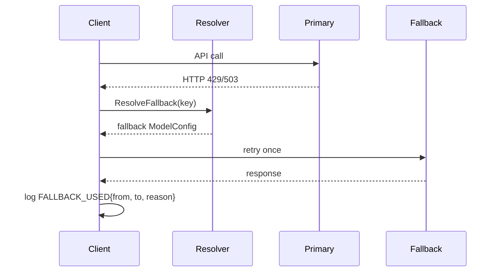

# config

Loads, validates, and provides runtime access to TradeEngine configuration.

## Components

| File | Responsibility |
|------|---------------|
| `config.go` | Type definitions, `Load()`, `Validate()`, `Resolve()` methods, env-var resolution |
| `defaults.go` | Canonical default values including the model registry |
| `config_test.go` | Unit tests for all config behaviours |

## Model Registry

All models used anywhere in the system are declared in `models.registry`. Components reference **role names** — not raw model strings. The engine resolves roles to providers at startup; unknown roles are a fatal error.

### Structure

```
models:
  registry:               # named model entries
    <key>:
      provider: ...
      model: ...
      api_key_env: ...
      max_tokens: ...
      temperature: ...
      timeout_sec: ...
      fallback: <key>     # optional: used on 429/503
  roles:                  # maps system roles → registry keys
    analysts: [...]       # ordered: cheap → mid → frontier
    arbiter: ...
    classifier: ...
    news_enricher: ...
    embedder: ...
```

### Resolution flow

```mermaid
graph LR
    A[Component needs model] --> B{registry present?}
    B -- yes --> C[Look up role in models.roles]
    C --> D[Look up key in models.registry]
    D --> E[Return ModelConfig]
    B -- no --> F[Legacy analysts[] / arbiter fields]
```

### Fallback flow



One hop only — no chaining.

### Resolver API

```go
// Look up a specific registry entry by key.
cfg.Models.Resolve("analyst_cheap") (ModelConfig, error)

// Look up a system role (arbiter, classifier, news_enricher, embedder).
cfg.Models.ResolveRole("classifier") (ModelConfig, error)

// Get fallback entry for a registry key (returns false if none defined).
cfg.Models.ResolveFallback("analyst_mid") (ModelConfig, bool)

// Return ordered analyst ModelConfigs (registry or legacy).
cfg.Models.AnalystConfigs() []ModelConfig

// Return arbiter ModelConfig (registry or legacy).
cfg.Models.ArbiterConfig() ModelConfig
```

## Validation

`Validate(cfg)` returns a list of error strings. Called at startup; non-empty list = fatal.

Registry validation rules:
- Every registry entry must have `provider` and `model`
- `fallback` key, if set, must resolve to another registry entry
- Every role key in `models.roles` must exist in `models.registry`
- `api_key_env`, if set, must be a non-empty environment variable

Legacy validation (when registry absent):
- `models.analysts[]` must contain ≥1 entry
- Ensemble requires ≥3 analysts when `consensus.enabled=true`

## Merge Order

```
Defaults() → YAML file → DB overrides → CLI flags
```

Explicit config values always override profile defaults.

## Backward Compatibility

The legacy `models.analysts[]`, `models.arbiter`, and `models.primary` fields continue to work when `models.registry` is absent. `AnalystConfigs()` and `ArbiterConfig()` are transparent: they return registry entries when available, legacy fields otherwise.

Legacy `news.extraction_provider/model` and `embeddings.provider/model` are resolved via `models.roles.news_enricher` and `models.roles.embedder` when registry is present.
