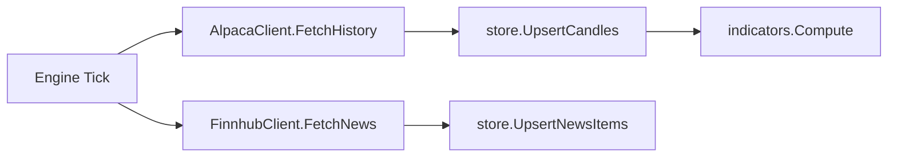

# internal/data — Market Data & News Providers

Defines the provider interfaces and concrete adapters for fetching market price data and financial news. All components are swappable via Go interfaces, so the engine code is never coupled to a specific provider.

## Components

| File | Purpose |
|------|---------|
| `provider.go` | `MarketDataProvider` interface + `Candle`, `Quote`, `Timeframe` types |
| `alpaca.go` | Alpaca REST adapter implementing `MarketDataProvider` |
| `news.go` | `NewsProvider` interface + `NewsItem` type |
| `finnhub.go` | Finnhub company news adapter implementing `NewsProvider` |

## Types

**`Candle`** — a single OHLCV bar, mapped 1:1 to the `candles` table:
```
Ticker | Timeframe | Timestamp | Open | High | Low | Close | Volume | VWAP
```

**`Quote`** — latest bid/ask/last for a ticker (fetched on demand for order sizing).

**`Timeframe`** — a string enum: `1m`, `5m`, `15m`, `1h`, `1d`.

**`NewsItem`** — a news article with headline, summary, source, tickers, and optional sentiment score.

## Interfaces

```go
type MarketDataProvider interface {
    FetchCandles(ctx, ticker, tf, from, to) ([]Candle, error)  // date-range fetch
    FetchQuote(ctx, ticker) (*Quote, error)                     // latest quote
    FetchHistory(ctx, ticker, tf, limit) ([]Candle, error)      // most recent N bars
}

type NewsProvider interface {
    FetchNews(ctx, ticker, since) ([]NewsItem, error)
}
```

## Adapters

### AlpacaClient
Uses [Alpaca Market Data API v2](https://docs.alpaca.markets/reference/stockbars). Auth via `APCA-API-KEY-ID` + `APCA-API-SECRET-KEY` headers.

- Rate limit: 200 req/min free tier → 300ms minimum interval between requests
- Handles pagination (`next_page_token`) automatically for large date-range fetches
- Timeframe mapping: `1m→1Min`, `5m→5Min`, `15m→15Min`, `1h→1Hour`, `1d→1Day`

### FinnhubClient
Uses [Finnhub Company News API](https://finnhub.io/docs/api/company-news). Auth via `token` query param.

- Rate limit: 60 req/min free tier → 1s minimum interval
- Returns articles published within a date range for a specific ticker
- Sentiment score derived from `bullishPercent - bearishPercent` (normalised to `[-1, 1]`)

## Data Flow



## Configuration

Both adapters read credentials from env vars (set in config.yaml):
```yaml
markets:
  stocks:
    api_key_env: ALPACA_API_KEY    # Required for market data
    secret_env: ALPACA_API_SECRET
    data_url: https://data.alpaca.markets
  news:
    provider: finnhub
    api_key_env: FINNHUB_API_KEY   # Required for news
    fetch_every_min: 15
```
