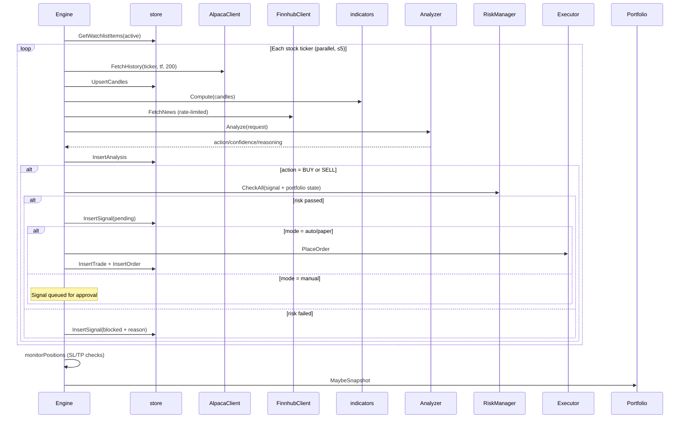
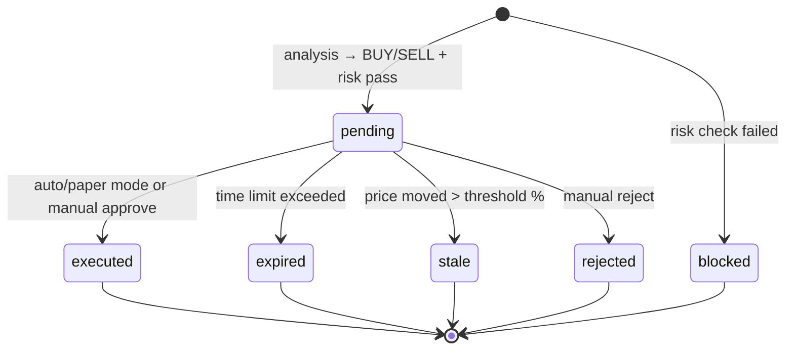

# internal/engine — Core Engine Loop, Trading, & Scheduler

The beating heart of TradeEngine. Orchestrates the per-tick pipeline: fetch candles → compute indicators → fetch news → analyse → generate signal → risk check → execute → monitor positions. Also owns market-hours detection, signal expiry, data retention, and US holiday scheduling.

## Components

| File | Purpose |
|------|---------|
| `engine.go` | `Engine` struct, `Run()` loop, per-ticker processing, signal generation, risk checks, execution, position monitoring, expiry, retention, backfill |
| `scheduler.go` | `IsMarketOpen()`, `NextTickTime()`, US holiday calendar |
| `engine_analysis_test.go` | Unit tests for `volRatio` and helpers |

## Engine

```go
type Engine struct {
    cfg          *config.Config
    marketData   data.MarketDataProvider  // Alpaca (or nil)
    newsProvider data.NewsProvider        // Finnhub (or nil)
    analyzer     *analysis.Analyzer       // LLM analysis dispatch
    executor     execution.Executor       // Paper or Alpaca broker
    portfolio    *portfolio.Tracker       // In-memory portfolio state
    mode         string                   // manual | auto | paper
}
```

**`New(cfg, market, news, executor, mode)`** — constructor. Falls back to `PaperExecutor` if executor is nil.

**`Run(ctx)`** — blocks until ctx is cancelled. Launches background goroutines for signal expiry and data retention. Fires tick immediately on start, then on each interval.

**`BackfillHistory(ctx, ticker)`** — fetches 2y daily + 30d hourly candles on `te watchlist add`.

## Per-Tick Pipeline (Phase 4)



## Signal Lifecycle



## Background Goroutines

| Goroutine | Interval | Purpose |
|-----------|----------|---------|
| `runSignalExpiryLoop` | 1 min | Expires pending signals past `signal_expiry_min`, marks stale if price moved > `stale_price_move_pct` |
| `runRetentionLoop` | 24 hours | Cleans up intraday candles > 90 days, analysis records > 6 months |

## Mode Router

| Mode | Behavior |
|------|----------|
| `auto` | Signals that pass risk → immediate execution |
| `paper` | Same as auto, but via Alpaca paper API (or PaperExecutor) |
| `manual` | Signals queued as `pending` — user approves via CLI (`te trades approve`) or Telegram |

Mode is set via `te mode <mode>` (persists to DB override).

## Position Monitoring

On each tick, after all tickers are processed, the engine checks every open trade:
1. Fetch current price (latest candle close)
2. Check stop-loss breach (direction-aware)
3. Check take-profit breach
4. If triggered → place exit order → close trade → record P&L → update portfolio

## Scheduler

**`IsMarketOpen(t)`** — NYSE/NASDAQ hours: Mon–Fri, 09:30–16:00 ET, excluding US holidays.

**US Holidays:** New Year, MLK Day, Presidents' Day, Good Friday, Memorial Day, Juneteenth, Independence Day, Labor Day, Thanksgiving, Christmas — with weekend observation rules.

## Parallelism & Rate Limiting

- **5 concurrent goroutines** per tick (semaphore)
- News: minimum **15 minutes** between fetches per ticker
- Signal expiry: **1 minute** check interval
