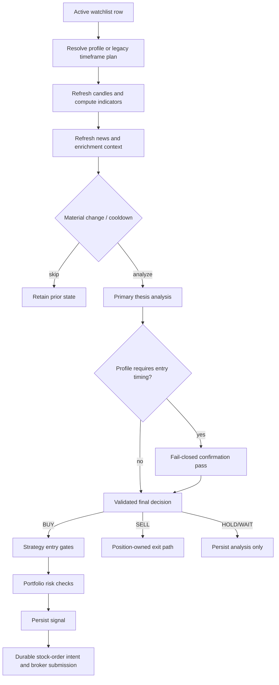

# internal/engine — Core Stock Engine

Orchestrates the standard equity cycle: refresh evidence, decide whether a new
analysis is warranted, run the configured analysis workflow, apply entry and
portfolio gates, create durable signals/orders, and reconcile open positions.
Specialized options, forex, and futures session runners live outside this
package and reuse lower-level strategy/execution components.

## Main Responsibilities

| Area | Files |
|---|---|
| Tick orchestration, persistence, and signal generation | `engine.go` |
| US market schedule and holidays | `scheduler.go` |
| Profile-owned primary/entry timeframe routing | `timeframe_workflow.go` |
| Legacy borderline multi-timeframe experiment | `multi_timeframe.go` |
| Strategy-specific deterministic entry checks | `entry_gates.go` |
| Material-change and analysis-cooldown decisions | `material_change.go` |
| Broker-authoritative BUY admission and durable intents | `stock_entry_admission.go`, `unfilled_entry.go` |
| SELL ownership, exit policy, and protective reconciliation | `sell_exit.go`, `exit_policy.go`, `exit_reconcile.go`, `broker_protection.go` |
| Bracket/trailing protection and initial stops | `bracket_exits.go`, `initial_stop.go` |
| Startup/runtime reconciliation | `reconcile.go`, `reconcile_persist.go` |

## Per-Ticker Cycle

A valid scanner execution profile owns the primary timeframe and optional
entry-timing timeframe. Profile confirmation cannot change the selected lens,
and unavailable or negative confirmation cannot fail open to a BUY. Rows
without a valid profile preserve the legacy timeframe behavior.

## Entry and Execution Safety

- Lens-specific checks cover pullback qualification, daily trend alignment,
  news tape reaction, and momentum anti-chase. Their ordered outcomes are
  stored on the signal.
- Portfolio risk receives the exact proposed whole-share quantity/notional and
  existing ticker exposure before submission.
- Stock BUYs use durable intent/attempt records and deterministic client order
  IDs so crash recovery can look up or replay ambiguous submissions safely.
- Buy pause and broker/account preflight controls block new risk without
  disabling SELLs or protective exits.
- Bracket, initial-stop, trailing-stop, and reconciliation paths preserve
  broker-resident protection and single-exit ownership.

## Signal Lifecycle

Signals may be `pending`, `approved`, `executed`, `blocked`, `expired`,
`stale`, or `rejected`. Manual mode queues eligible signals for CLI/Telegram
approval; auto and paper modes submit eligible signals immediately through the
configured executor. Blocked decisions are retained with their specific gate or
risk reason for audit.

## Background Work

- signal expiry and stale-price checks;
- retention cleanup;
- position monitoring and software exits where broker protection is not the
  configured owner;
- feedback review, cost/budget accounting, and notification batching; and
- startup plus periodic order/position reconciliation.

Use `te stocks preflight` before enabling stock execution, and use
`te buys pause|resume|status` for the operational new-buy circuit breaker.
