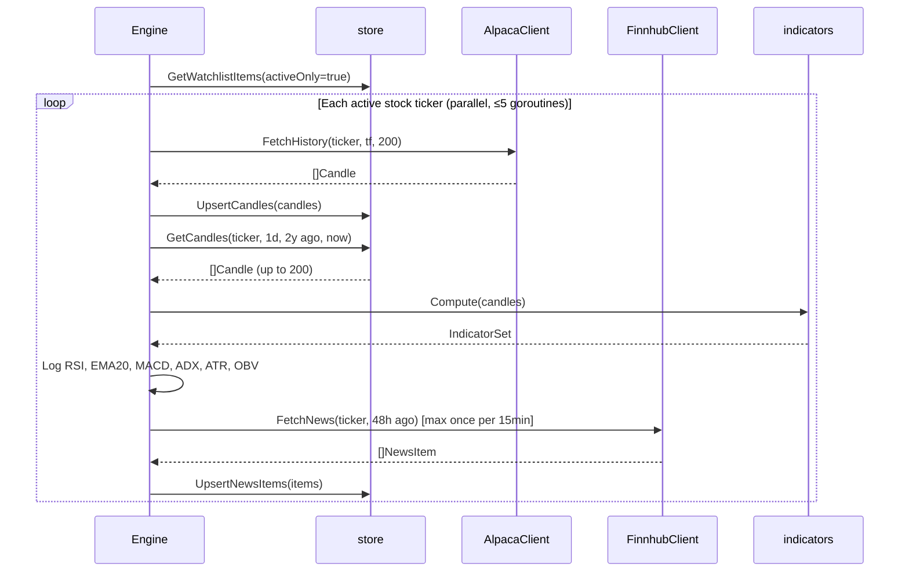

# internal/engine — Core Engine Loop & Scheduler

The beating heart of TradeEngine. Orchestrates the per-tick pipeline: fetch candles → compute indicators → fetch news → (Phase 3+) analyse → signal → execute. Also owns market-hours detection and US holiday scheduling.

## Components

| File | Purpose |
|------|---------|
| `engine.go` | `Engine` struct, `Run()` loop, per-ticker processing, backfill |
| `scheduler.go` | `IsMarketOpen()`, `NextTickTime()`, US holiday calendar |

## Engine

```go
type Engine struct {
    cfg          *config.Config
    marketData   data.MarketDataProvider  // Alpaca (or nil if unconfigured)
    newsProvider data.NewsProvider        // Finnhub (or nil if unconfigured)
    mode         string                   // manual | auto | paper
}
```

**`New(cfg, market, news, mode)`** — constructor. Accepts nil providers; engine degrades gracefully (logs warnings, skips fetch steps).

**`Run(ctx)`** — blocks until ctx is cancelled. Fires immediately on start, then on each tick interval. Skips ticks when market is closed.

**`BackfillHistory(ctx, ticker)`** — called on `te watchlist add`. Fetches 2 years of daily + 30 days of hourly candles from Alpaca and upserts into the database.

## Per-Tick Pipeline (Phase 2)



## Scheduler

**`IsMarketOpen(t)`** — returns true if NYSE/NASDAQ is open at time `t`. Checks:
1. Weekday (Mon–Fri only)
2. Not a US stock exchange holiday
3. 09:30–16:00 US/Eastern

**`NextTickTime(now, interval)`** — returns `now + interval` if the market will be open then, otherwise returns the next 09:30 ET on a trading day.

**US Holidays covered:**
New Year's Day, MLK Day, Presidents' Day, Good Friday, Memorial Day, Juneteenth, Independence Day, Labor Day, Thanksgiving, Christmas — all with weekend observation rules.

## Parallelism & Rate Limiting

The engine runs up to **5 concurrent goroutines** per tick (semaphore via `chan struct{}`). This limits burst API usage while still processing a 20-item watchlist in parallel.

News fetches are additionally rate-limited per ticker: minimum **15 minutes** between fetches for the same ticker, regardless of tick frequency.

## Configuration

```yaml
engine:
  tick_interval_sec: 300  # 5-minute ticks
  mode: paper             # manual | auto | paper
```

The engine respects the `mode` DB override (set via `te mode <mode>`) without restart.
