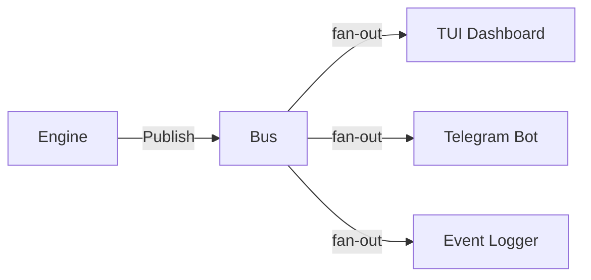

# internal/events

Channel-based publish-subscribe event bus for the engine pipeline.

## Purpose

Decouples the engine's pipeline stages from consumers (TUI dashboard, Telegram bot, logging). The engine emits typed events at each stage; subscribers receive them via buffered channels without blocking the main loop.

## Components

| File | Purpose |
|------|---------|
| `bus.go` | `Bus` struct with `Publish`, `Subscribe`, `SubscribeAll`, `Unsubscribe` |
| `types.go` | Event type constants and typed payload structs |

## Event Types

| Type | Emitted When |
|------|-------------|
| `data.fetched` | Candles fetched and stored |
| `indicators.computed` | Technical indicators calculated |
| `analysis.completed` | LLM analysis returned a result |
| `signal.generated` | Signal created (passed risk) |
| `signal.blocked` | Signal failed risk checks |
| `signal.expired` | Pending signal expired (time/price) |
| `signal.queued` | Signal queued for manual approval |
| `risk.check_completed` | Risk checks finished for a signal |
| `trade.executed` | Trade opened via executor |
| `trade.closed` | Trade closed (SL/TP/manual) |
| `position.updated` | Position state refreshed |
| `portfolio.snapshot` | Portfolio snapshot written |
| `error` | Non-fatal pipeline error |

## Architecture



## Usage

```go
// Subscribe to specific type
sub := bus.Subscribe(events.TradeExecuted)
go func() {
    for ev := range sub.C {
        payload := ev.Payload.(events.TradeExecutedPayload)
        // handle
    }
}()

// Subscribe to everything
allSub := bus.SubscribeAll()

// Unsubscribe when done
bus.Unsubscribe(sub)
```

## Design Decisions

- **Non-blocking publish**: If a subscriber's buffer is full, events are dropped (not queued). This prevents a slow subscriber from stalling the engine.
- **Buffered channels**: Default buffer size = 256 events per subscriber.
- **Wildcard subscriptions**: `SubscribeAll()` receives all event types via a `"*"` key.
- **Thread-safe**: `sync.RWMutex` protects the subscription map.
