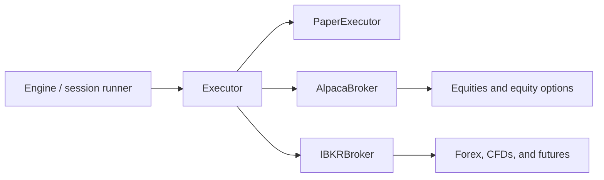

# internal/execution — Broker Adapters

Defines the shared order contract and broker-facing implementations used by
stock, options, forex/CFD, and futures workflows.

## Components

| Area | Purpose |
|---|---|
| `executor.go` | `Executor`, order/result/position types, bracket and contract metadata |
| `paper.go` | Local immediate-fill simulator for development and replay |
| `alpaca_broker.go`, `alpaca_options.go` | Alpaca stock/options trading and option-chain access |
| `ibkr_broker.go`, `ibkr_conid.go` | IBKR CASH, CFD, and futures contract resolution/execution |
| `brokerview.go`, `alpaca_brokerview.go`, `ibkr_brokerview.go` | Read-only broker order/position views for reconciliation |
| `account_validation.go` | Stock-account identity, status, freshness, and capability checks |
| `read_only.go` | Wrapper that rejects mutating broker operations |
| `trailing/` | Persistent server-side trailing-stop manager |

## Executor Contract

`Executor` places, cancels, and looks up orders; lists positions; and reads
account state. Optional capability interfaces add broker-order views and stop
replacement where supported. `OrderRequest` carries instrument identity
(`CASH`, `CFD`, futures contract ID, or OCC option contract), order prices,
bracket children, time in force, deterministic client-order IDs, and durable
coordinator metadata.

Broker adapters preserve the distinction between:

- definitive rejection, where no order was accepted;
- ambiguous transport/5xx/duplicate-client-ID outcomes, which require lookup;
- terminal zero-fill outcomes, which allow a deliberate next-generation retry;
  and
- accepted/partially filled orders, which must be projected and reconciled.

This distinction is essential to preventing duplicate entries or duplicate
protective stops after a crash or timeout.

## Implementations

Alpaca can target paper or live endpoints according to validated stock
configuration. The options path requires real-time OPRA data for live chain
decisions and fails closed on the delayed indicative feed. IBKR uses exact
contract identity for lifecycle operations and exposes keepalive/terminal
status helpers for long-running sessions.

`PaperExecutor` is thread-safe and fills at the provided reference/limit price;
it is not broker truth and does not replace broker reconciliation tests.
