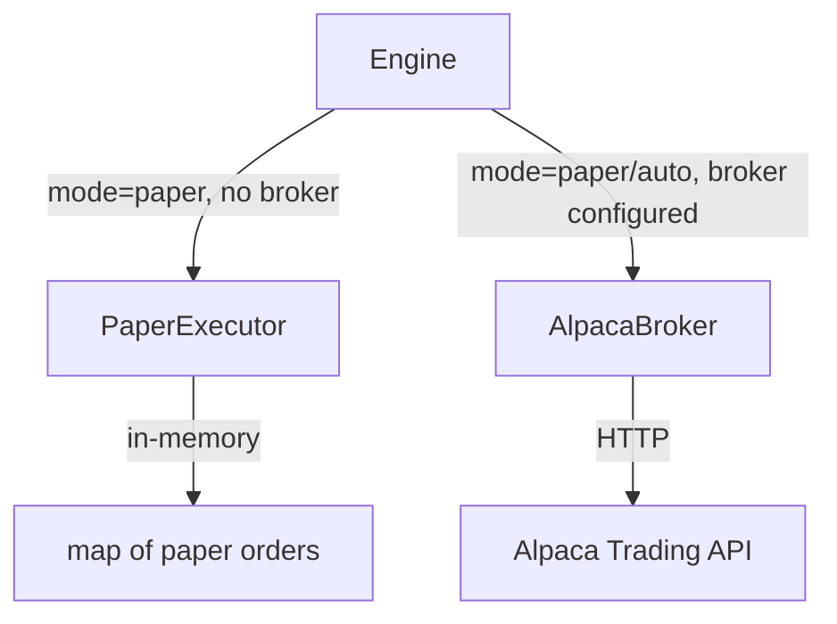

# internal/execution

Order execution adapters. Defines the `Executor` interface and provides two implementations.

## Purpose

Abstracts order placement so the engine can swap between paper simulation, Alpaca paper trading, and (eventually) live broker execution without changing core logic.

## Components

| File | Description |
|------|-------------|
| `executor.go` | `Executor` interface + shared types (`OrderRequest`, `OrderResult`, `Position`) |
| `paper.go` | `PaperExecutor` — local in-memory simulator. Fills immediately at provided price. |
| `alpaca_broker.go` | `AlpacaBroker` — HTTP adapter for Alpaca Trading API (paper or live). |

## Executor Interface

```go
type Executor interface {
    PlaceOrder(ctx, OrderRequest) (OrderResult, error)
    CancelOrder(ctx, brokerOrderID) error
    GetOrderStatus(ctx, brokerOrderID) (OrderResult, error)
    GetPositions(ctx) ([]Position, error)
}
```

## Architecture



## Selection Logic

The engine constructor (`engine.New`) receives an `Executor`. If nil, it falls back to `PaperExecutor`. The CLI (`run.go`) builds `AlpacaBroker` when Alpaca API keys are configured.

## Paper Executor Notes

- Thread-safe (mutex-protected map).
- All fills are immediate at the provided `LimitPrice` (or `StopPrice` for stop orders).
- `GetPositions` returns empty — position state is tracked by the `portfolio` package.
- Used by: backtesting engine (Phase 7), local development, fallback when no broker configured.
