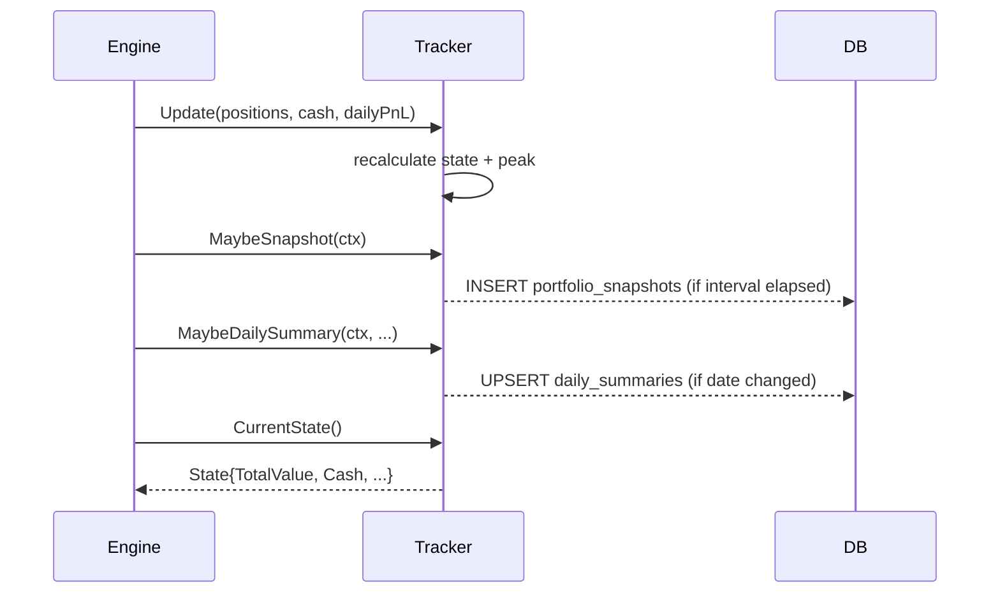

# internal/portfolio

Portfolio state tracking, snapshots, and daily summaries.

## Purpose

Maintains an in-memory view of the current portfolio (total value, cash, positions, P&L) and persists periodic snapshots and daily summaries to the database for historical analysis and reporting.

## Components

| Component | Description |
|-----------|-------------|
| `Tracker` | In-memory portfolio state machine. Tracks total value, cash, invested amount, unrealized P&L, peak value (for drawdown), and last loss timestamp. |
| `State` | Snapshot of current portfolio values (exported for reads by risk manager and CLI). |
| `MaybeSnapshot` | Writes a `portfolio_snapshots` row at the configured interval (default: 1 hour). |
| `MaybeDailySummary` | Writes a `daily_summaries` row once per calendar day. Uses `ON CONFLICT` upsert. |

## Data Flow

## Integration Points

- **Engine**: calls `Update()` after each position monitoring cycle, reads `CurrentState()` for risk checks and signal sizing.
- **Risk manager**: reads `PeakValue` for drawdown check, `LastLossAt` for cooldown check.
- **CLI (`te status`)**: reads `CurrentState()` for portfolio display.

## Database Tables

- `portfolio_snapshots` — hourly snapshots of portfolio value, cash, invested, P&L.
- `daily_summaries` — one row per day with trade counts, win/loss, token usage, net P&L.
