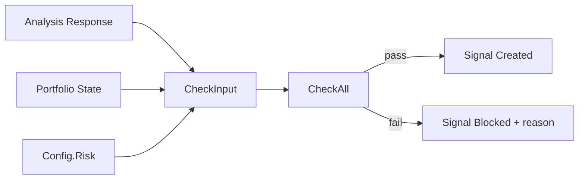

# internal/risk

Risk management gate for the trading engine. Implements all PRD §9.1 checks.

## Purpose

Every signal generated by the analysis engine must pass through the risk manager before execution. The risk manager runs a series of checks in a defined order and short-circuits on the first failure. Failed signals are stored with `status=blocked` and a human-readable `block_reason`.

## Checks (in order)

| # | Check | Config Key | Description |
|---|-------|-----------|-------------|
| 1 | Confidence threshold | `confidence_threshold` | Signal confidence must meet minimum |
| 2 | Risk-reward ratio | `min_risk_reward` | Reward/risk ratio from stop-loss and take-profit |
| 3 | Position size limit | `max_position_pct` | Size % must not exceed portfolio cap |
| 4 | Max open positions | `max_open_positions` | Total open trades must be under limit |
| 5 | Daily loss limit | `daily_loss_limit_pct` | Realized daily loss as % of portfolio |
| 6 | Max drawdown | `max_drawdown_pct` | Circuit breaker: portfolio drawdown from peak |
| 7 | Cooldown after loss | `cooldown_after_loss_min` | Time gate after last losing trade |

## Data Flow



## Usage

```go
results, passed := risk.CheckAll(input)
if !passed {
    reason := risk.BlockReason(results)
    // block the signal
}
```

All checks are pure functions — no database or network I/O. The caller (engine) provides all necessary state via `CheckInput`.
