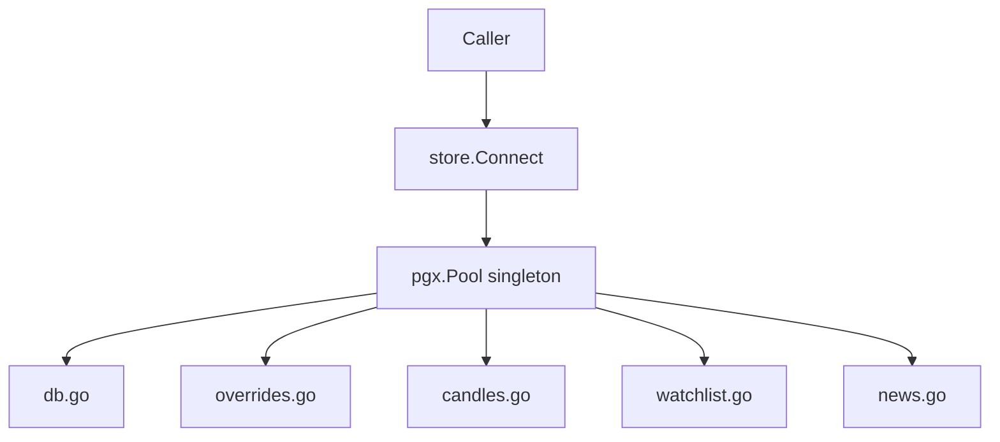

# internal/store — Database Access Layer

All PostgreSQL interactions. Each file owns one table or a related group of tables. The package exposes package-level functions backed by a singleton pgx/v5 connection pool; call `store.Connect(ctx)` before use and `store.Close()` on shutdown.

## Components

| File | Table(s) | Purpose |
|------|---------|---------|
| `db.go` | `schema_migrations` | Pool management, migration runner |
| `overrides.go` | `config_overrides` | DB-backed runtime config overrides |
| `candles.go` | `candles` | OHLCV bar storage and retrieval |
| `watchlist.go` | `watchlist` | Watchlist CRUD |
| `news.go` | `news_items` | News article storage and retrieval |
| `analyses.go` | `analyses` | LLM analysis persistence and retrieval |

## Architecture

The pool is a package-level singleton initialized by `Connect(ctx)`. All other functions call `GetDB()` to access it. `Close()` releases the pool on shutdown.

## Key Behaviours

**Candles (`candles.go`)**
- `UpsertCandles` batches inserts in chunks of 500 rows (8 params × 500 = 4,000 params, well within Postgres 65k limit)
- Conflict target: `(ticker, timeframe, ts)` — reinserting the same bar is a no-op
- `GetLatestCandle` returns `nil, nil` if no candle exists (used to detect first-time backfill)

**Watchlist (`watchlist.go`)**
- `AddWatchlistItem` uses `INSERT ... ON CONFLICT DO UPDATE` — re-adding a removed ticker re-enables it
- `RemoveWatchlistItem` is a soft delete (`active = false`); history is preserved
- `GetWatchlistItems(activeOnly=true)` is the call used by the engine loop

**News (`news.go`)**
- `UpsertNewsItems` deduplicates on `external_id` (Finnhub article ID)
- URL uniqueness is enforced by the `UNIQUE` constraint on the `news_items.url` column
- `GetRecentNews(ticker, since)` uses a GIN index on `tickers[]` for efficient array lookup

**Analyses (`analyses.go`)**
- `InsertAnalysis` writes the full model output + metadata (`raw_prompt`, `raw_response`, token usage, latency)
- `prompt_hash` stores SHA-256 of the exact prompt text for reproducibility/caching
- `indicators` stores a JSONB snapshot of technical inputs used for the recommendation
- `GetAnalysesByTicker` and `GetAnalysisByID` support audit/review tooling

**Overrides (`overrides.go`)**
- All engine settings (mode, tick interval, etc.) can be overridden at runtime via `te config set --runtime`
- Overrides are read on each tick and on `te status`

## Error Handling

`isNoRows(err)` detects pgx/v5 "no rows" via string matching (pgx v5 does not export a sentinel error type). Returns `nil, nil` for single-row queries that find nothing — callers must nil-check before dereferencing.

## Migration Runner

`Migrate(ctx)` reads all `.sql` files from the embedded `migrations/` directory, tracks applied migrations in `schema_migrations`, and runs each unapplied file in a transaction. See `db.go` for implementation details.
