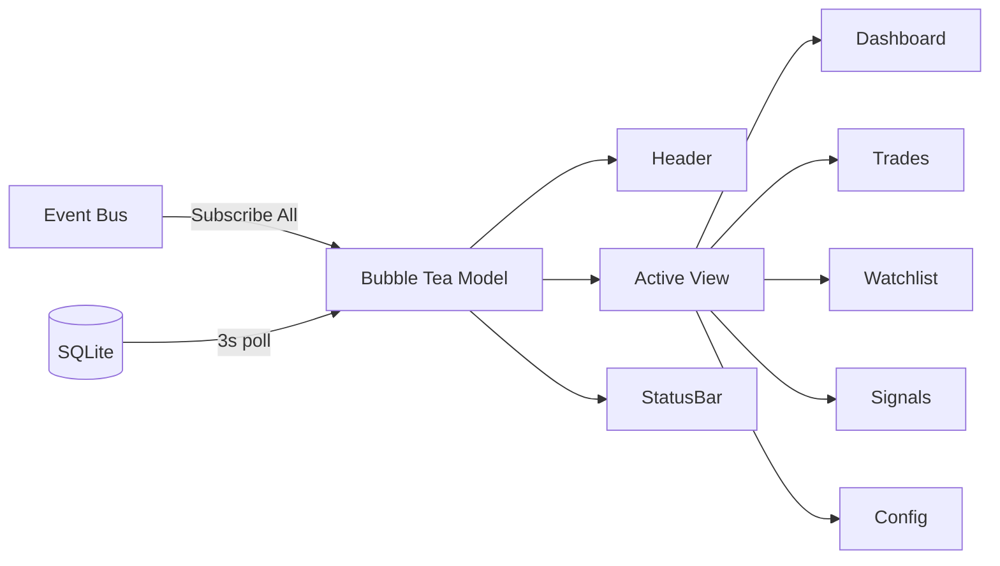

# internal/tui — Terminal Dashboard

Bubble Tea TUI for TradeEngine. Provides a full-screen terminal dashboard with
real-time engine event streaming and DB polling fallback.

## Architecture



## Components

| File | Purpose |
|------|---------|
| `app.go` | Main Bubble Tea model, update loop, view router, event bus wiring |
| `views/` | Per-view models (5.3–5.9) |
| `components/` | Reusable widgets — tables, sparklines, gauges (5.10) |

## Data Flow

1. **Event bus** — The TUI subscribes to all engine events via `bus.SubscribeAll()`.
   Events arrive on a buffered channel and are converted to `eventMsg` tea messages.
2. **DB polling** — Every 3 seconds a `pollTickMsg` fires. Views use this to refresh
   data from SQLite (positions, trades, signals) as a fallback when the engine isn't
   running or events aren't flowing.
3. **View rendering** — The active view renders into the body area. Header shows tabs;
   status bar shows keyboard shortcuts and last event timestamp.

## Navigation

| Key | Action |
|-----|--------|
| `1`–`5` | Jump to view |
| `Tab` / `Shift+Tab` | Cycle views |
| `q` / `Ctrl+C` | Quit |

## Usage

```bash
te dashboard    # or: te ui, te tui
```
