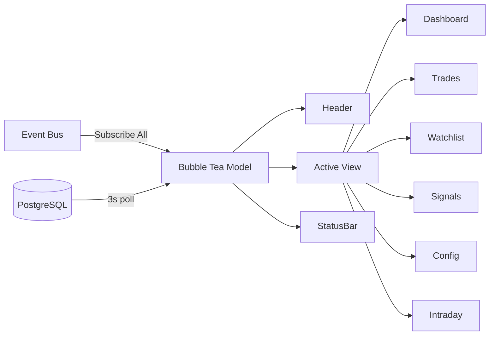

# internal/tui - Terminal Dashboard

Bubble Tea TUI for TradeEngine. Provides a full-screen terminal dashboard with
real-time engine event streaming and DB polling fallback.

## Architecture



## Components

| File | Purpose |
|------|---------|
| `app.go` | Main Bubble Tea model, update loop, view router, event bus wiring |
| `views/` | Per-view models (5.3–5.9) |
| `components/` | Reusable widgets: tables, sparklines, gauges |

## Data Flow

1. **Event bus** - The TUI subscribes to all engine events via `bus.SubscribeAll()`.
   Events arrive on a buffered channel and are converted to `eventMsg` tea messages.
2. **DB polling** - Every 3 seconds a `pollTickMsg` fires. Views use this to refresh
   data from PostgreSQL (positions, trades, signals, intraday sessions) as a fallback when the engine isn't
   running or events aren't flowing.
3. **View rendering** - The active view renders into the body area. Header shows tabs;
   status bar shows keyboard shortcuts and last event timestamp.

## Navigation

| Key | Action |
|-----|--------|
| `1`-`6` | Jump to Dashboard, Trades, Watchlist, Signals, Config, or Intraday |
| `Tab` / `Shift+Tab` | Cycle views |
| `j` / `k` or arrows | Move or scroll within the active view |
| `q` / `Ctrl+C` | Quit |

### Intraday history

The Intraday view has independent strategy and history navigation:

| Key | Action |
|-----|--------|
| `o` | Show ORB history, including equities, options, forex, metals, and futures |
| `c` | Show currency-strength decisions and paper-order history |
| `j` / `k` | Scroll within the loaded page |
| `h` / `l` or left/right | Load a newer or older database page |

ORB pages contain six sessions. Currency-strength pages contain eight daily
runs. Currency-strength rows retain no-signal and failure outcomes as well as
entries and flatten submissions, so a day remains inspectable even when no
trade was placed.

## Usage

```bash
te dashboard    # or: te ui, te tui
```
